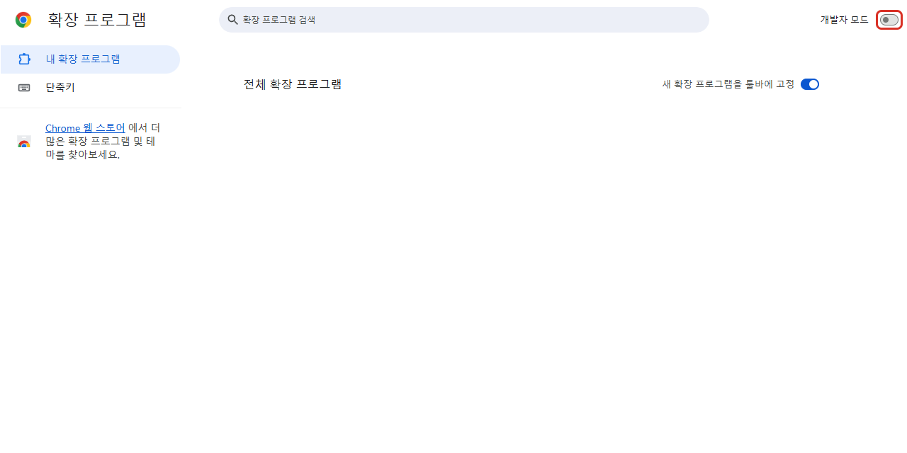
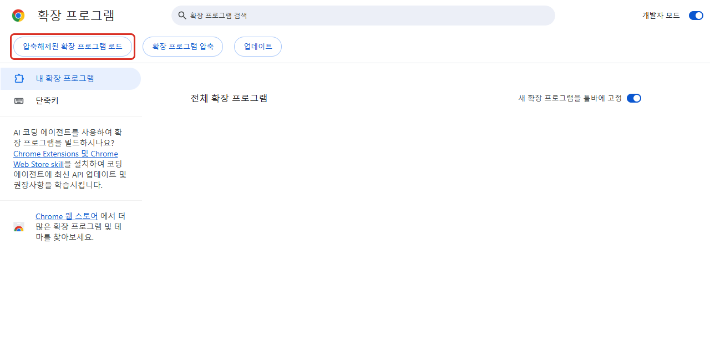
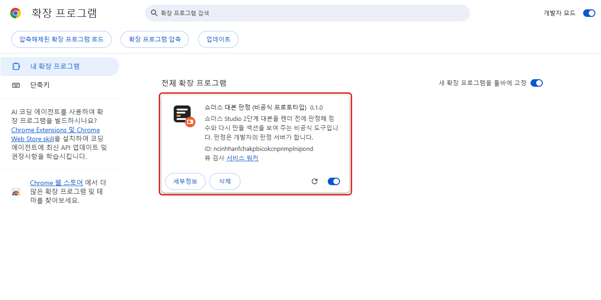
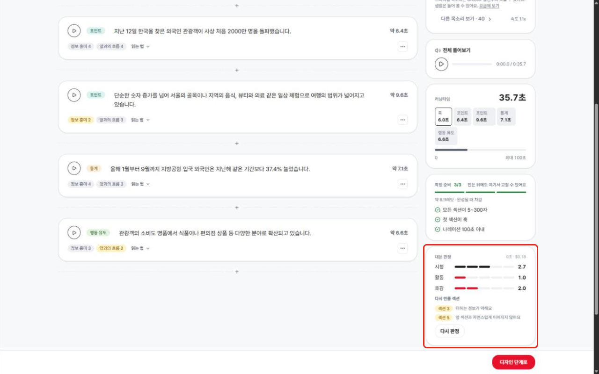
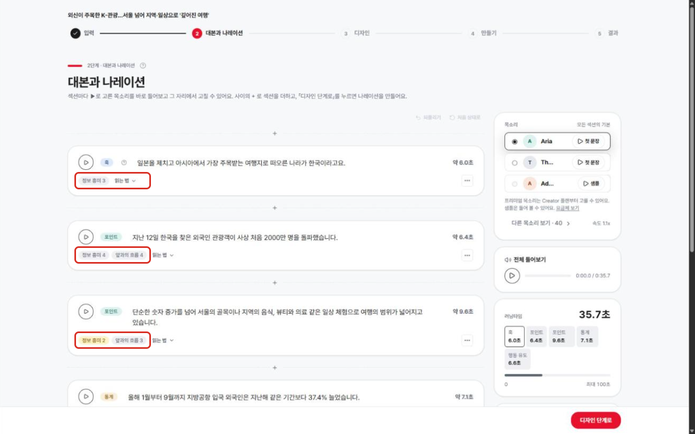

# 쇼더스 대본 판정기

쇼더스 2단계 '대본과 나레이션'의 대본을 렌더 전에 시청·활동·호감 세 묶음으로 판정한다. 기준·판정 방식·검증은 [REPORT.md](REPORT.md)에, 결정과 판단 과정은 [DECISIONS.md](DECISIONS.md)에 있다.

## 평가자용: 크롬 확장으로 써 보기

API 키는 필요 없다. 판정은 개발자가 운영하는 판정 서버가 개발자의 키로 한다. 평가자는 확장만 불러오면 된다.

### 1. 확장 받기

[Releases](../../releases/latest)에서 `shortus-judge-extension-0.1.0.zip`을 받아 압축을 푼다. 풀린 폴더 안에 `manifest.json`이 있으면 된다.

### 2. 개발자 모드 켜기

Chrome 주소창에 `chrome://extensions`를 입력하고, 오른쪽 위 '개발자 모드'를 켠다.



### 3. 확장 불러오기

왼쪽 위에 생긴 '압축해제된 확장 프로그램 로드'를 누르고, 1에서 푼 폴더(`manifest.json`이 들어 있는 폴더)를 고른다.



아래처럼 '쇼더스 대본 판정 (비공식 프로토타입)' 카드가 보이면 설치가 끝난 것이다. ID는 `ncinhhanfchakpbicokcnpnmplnipond`여야 한다. 판정 서버는 이 ID에서 온 요청만 받는다.



### 4. 쇼더스에서 판정하기

1. [쇼더스 Studio](https://shortus.viewus.co.kr/studio)에서 글이나 기사 링크로 쇼츠를 만들고 2단계 '대본과 나레이션'을 연다. 확장을 깔기 전에 열어 둔 탭은 새로 고친다.
2. 오른쪽 '확정 준비' 카드 아래에 '대본 판정' 카드가 붙는다. '판정하기'를 누르면 10~20초쯤 뒤에 결과가 뜬다.
3. 판정한 대본은 서버에 저장돼, 다시 열면 결과가 바로 뜬다. 섹션을 고친 뒤에는 '다시 판정'을 누른다.

### 5. 결과 읽기

판정 카드에는 시청·활동·호감 세 묶음의 점수(1~5)와 다시 만들 섹션, 그 이유가 나온다.



섹션마다 '정보 흥미'와 '앞과의 흐름'(첫 섹션은 '정보 흥미'만) 단계가 붙는다. 약한 단계는 노랗게 표시된다. 질문과 단계의 뜻은 [REPORT.md](REPORT.md)에 있다.



### 안 될 때

- 카드가 안 보인다: 2단계 화면인지, `chrome://extensions`에서 확장이 켜져 있는지 보고 탭을 새로 고친다.
- '판정 서버에 연결하지 못했어요': 판정 서버가 잠시 꺼져 있다. 잠시 뒤 다시 누른다.
- '판정 요청이 많아요': 같은 IP에서 한 시간에 새 판정을 10번까지 받는다. 한 시간쯤 뒤에 다시 누른다.
- '오늘 판정 한도에 닿았어요': 판정 서버에 하루 요금 상한이 있다. 다음 날 다시 판정할 수 있고, 이미 판정한 대본은 계속 볼 수 있다.

판정을 누르면 대본 글이 개발자의 판정 서버로 가고, 서버가 Anthropic API로 판정한다. 서버는 판정 결과와 대본 글을 저장한다. IP는 시간당 제한에만 쓰고 메모리에 한 시간만 둔다.

## 실행

```bash
npm install
npm test
```

```bash
# 실제 판정(인증 필요). 응답을 fixtures/에 저장한다
npm run judge -- data/scripts/S00.json --record
```

```bash
# 저장한 응답으로 다시 실행(API를 부르지 않음). 지금 프롬프트 버전의 응답은 data/scripts의 대본 13개 모두에 있다
npm run judge -- data/scripts/S00.json --replay
```

옵션: `--model`(기본 claude-opus-5-5), `--effort low|medium|high|xhigh|max`(기본 low), `--speed standard|fast`(기본 fast, 표준 속도의 2배 요금), `--window 3`(첫 구간 초), `--boundary end|start`, `--out runs`

## 검증

기준을 반복해서 고치며 잰 과정은 [docs/iterations.md](docs/iterations.md)에, 기준마다의 근거는 [docs/evidence.md](docs/evidence.md)에 있다.

```bash
# 검증 묶음 전부: 방향 시험(결함·개선·대조·편향 변형), 독립 참조 판정과의 일치, 반복 안정성을 재고 끝내는 조건과 맞대어 본다
npm run eval -- suite
```

```bash
# 홀드아웃(data/holdout)으로 같은 검증. 기준을 고치는 동안에는 쓰지 않는다
npm run eval -- suite --pool holdout
```

```bash
# 방향 시험만
npm run eval -- variants
```

```bash
# 사람 검토 문서: 세트의 대본마다 대본 전문과 항목별 단계·이유·근거·감사 의견(기본 시험용 세트, --set 개발|all)
npm run eval -- review
```

```bash
# 사람 판정 일치도: 판정시트.xlsx에 판정을 보기 전 사람 판정을 적었을 때 판정기 결과와 비교
npm run eval -- agreement
```

저장된 응답(`fixtures/<프롬프트 버전>/`)이 있는 대본만 비교한다. `--record`를 붙이면 응답이 없는 대본을 실제로 판정해 저장한다(인증 필요, 판정당 표준 속도 약 $0.18, 고속 약 두 배). 일치도 비교는 사람 판정을 적은 대본만 판정하므로, 판정기 결과를 보기 전에 사람 판정을 적는 순서가 지켜진다. 결과는 `runs/eval/`에 남고, 실제 판정 요금은 `runs/eval/ledger.jsonl`에 쌓인다. 변형 대본은 `npx tsx scripts/make-variants.ts`(홀드아웃은 `holdout`을 붙임)로, 단계 기준표를 고치면 `npx tsx scripts/sync-anchors.ts`로 DECISIONS 8번 표를 맞추고, 참조 판정자용 안내서는 `npx tsx scripts/make-rater-pack.ts <폴더> <대본...>`으로 다시 만든다. 옵션: `--speed standard`(반복 중 요금 절반), `--concurrency 4`, `--max-spend 10`(이번 실행 요금 상한), `--stability`(다시 판정해 안정성도 잼)

## 크롬 확장 직접 빌드(로컬 판정 서버)

확장을 저장소에서 빌드해 이 PC의 로컬 판정 서버에 붙인다. 실제 판정에는 인증이 필요하다(아래 '인증').

```bash
npm run build:ext
```

```bash
# 실제 판정(인증 필요)
npm run serve
```

```bash
# 데모: data/scripts에 있는 대본만 저장된 응답으로 판정(API를 부르지 않음)
npm run serve:replay
```

1. `chrome://extensions`에서 개발자 모드를 켠다.
2. '압축해제된 확장 프로그램 로드'로 `extension/` 폴더를 고른다.
3. 쇼더스 Studio에서 쇼츠의 2단계 '대본과 나레이션'을 연다. 같은 대본을 판정한 적이 있으면 결과가 바로 뜨고, 없으면 '판정하기'를 누른다.

서버는 127.0.0.1:8787에서만 듣고 확장 프로그램에서 온 요청만 받는다. 판정 결과는 `runs/ext-cache/`에 저장해 같은 대본은 다시 부르지 않는다. 매니페스트의 `key`로 확장 ID를 고정해, 어느 폴더에서 불러와도 ID가 같다.

## 공개 판정 서버(Portainer 스택 + Tailscale Funnel)

평가자용 확장이 부르는 서버다. 미니 PC(Linux + Docker)에서 Portainer 스택 하나로 판정 서버와 Tailscale 컨테이너를 같이 띄우고, Tailscale Funnel로 HTTPS 공개 주소를 만든다. 도메인, 공유기 포트포워딩, 미니 PC 셸 접속은 필요 없다. 판정 서버는 포트를 열지 않고, 같은 스택의 Tailscale 컨테이너만 닿는다.

1. Portainer에서 Stacks → Add stack을 열고 아래처럼 채운 뒤 Deploy the stack을 누른다. 판정 서버 이미지를 저장소에서 빌드하므로 처음에는 몇 분 걸린다.
   - Name: `shortus-judge`
   - Build method: Repository
   - Repository URL: `https://github.com/paulleebm/shortus-script-judge`
   - Repository reference: `refs/heads/main`
   - Compose path: `docker-compose.yml`
   - Environment variables: `ANTHROPIC_API_KEY`에 키를 넣는다(Portainer에만 저장되고 저장소에는 들어가지 않는다)
2. Containers에서 `shortus-judge-tailscale-1`의 Logs를 열고, `To authenticate, visit:` 뒤의 주소로 Tailscale에 로그인한다. 처음 한 번만 하면 된다.
3. 같은 컨테이너의 Console(`/bin/sh`)에서 Funnel을 켠다. 처음이면 tailnet에서 HTTPS와 Funnel을 허용하라는 주소가 나온다. 허용한 뒤 다시 실행한다. 이 설정은 컨테이너를 다시 켜도 남는다.

```bash
tailscale funnel --bg http://judge:8787
```

```bash
# 공개 주소(https://shortus-judge.<tailnet 이름>.ts.net) 확인
tailscale funnel status
```

4. 그 주소를 넣어 평가자용 확장 zip을 만들고(`runs/release/shortus-judge-extension-<버전>.zip`) Releases에 올린다.

```bash
node scripts/package-extension.mjs https://shortus-judge.<tailnet 이름>.ts.net
```

Portainer 없이 명령으로 띄울 때는 저장소 루트의 `.env`(저장소에 올라가지 않음)에 `ANTHROPIC_API_KEY=…`를 두고 `docker compose up -d --build`를 실행한다. 2는 `docker compose logs tailscale`, 3은 `docker compose exec tailscale sh`에서 한다.

환경 변수(비우면 괄호 안 값): `JUDGE_EXTENSION_IDS`(받을 확장 ID, 고정한 확장 ID), `JUDGE_RATE_PER_HOUR`(IP마다 시간당 새 판정 수, 10), `JUDGE_DAILY_BUDGET_USD`(하루 새 판정 요금 상한, 한국 시간 기준, 서버를 다시 켜도 유지, 5), `TS_HOSTNAME`(공개 주소의 기기 이름, shortus-judge). 상한에 닿으면 그날은 새 판정만 막고 저장된 결과는 계속 돌려준다. 확장 ID는 브라우저 밖에서 꾸밀 수 있으므로 요금을 실제로 막는 것은 하루 상한이다.

## 인증

코드에 키를 넣지 않는다. Workload Identity Federation으로 Google Cloud 서비스 계정의 신원 토큰을 짧게 쓰는 접근 토큰으로 바꿔 쓴다. 설정 순서는 [docs/wif-setup.md](docs/wif-setup.md)에 있다.

- 페더레이션 ID들은 `.env.local`에 둔다(`.env.example` 참고, 저장소에 올라가지 않음).
- `JUDGE_IDENTITY_TOKEN_COMMAND`를 비워 두면 SDK 기본 탐색을 쓴다(`ANTHROPIC_IDENTITY_TOKEN_FILE` 같은 환경 변수나 `ant auth login` 프로필).
- API 키로 돌리려면 `JUDGE_IDENTITY_TOKEN_COMMAND`를 비우고 `ANTHROPIC_API_KEY` 환경 변수를 둔다(SDK 기본 탐색). 공개 판정 서버 컨테이너는 이 방식을 쓴다.
- `npm run auth:check`로 요금 없이 인증만 확인한다.
- 인증 없이도 `npm test`, `--replay`, `npm run serve:replay`, `npm run eval`(저장된 응답이 있는 대본)은 돈다.

## 판정 흐름

1. 규칙: 섹션별 초와 음절 수로 첫 3초를 잘라 내고, 섹션 구성을 확인한다.
2. LLM 호출을 동시에 보낸다: 시청1(제목과 첫 3초만), 시청2·3(섹션과 연결부, 같은 질문을 세 번 물어 항목마다 가운데값), 활동, 호감.
3. 인용이 대본에 글자 그대로 있는지 대조하고, 단계와 묶음 점수는 코드가 계산한다.
4. 모든 판정을 정리본으로 모아 한 번 더 LLM에 보내 공정했는지 감사한다. 감사는 판정을 고쳐 쓰지 않고, 2단계 이상 다르게 본 항목을 '불확실'로 돌린다.

## 결과

`runs/<대본ID>-<시각>/`

- `result.json`: 감사 전후 결과, 첫 3초, 비용 어림
- `requests.json`: 보낸 요청과 받은 응답 전부
- `summary.md`: 정리본과 감사 결과

## 대본 파일 형식

`data/scripts/S00.json` 참고. `sections`는 `order`(1부터), `role`(훅·포인트·행동 유도·기타), `narration`, `seconds`를 가진다.
